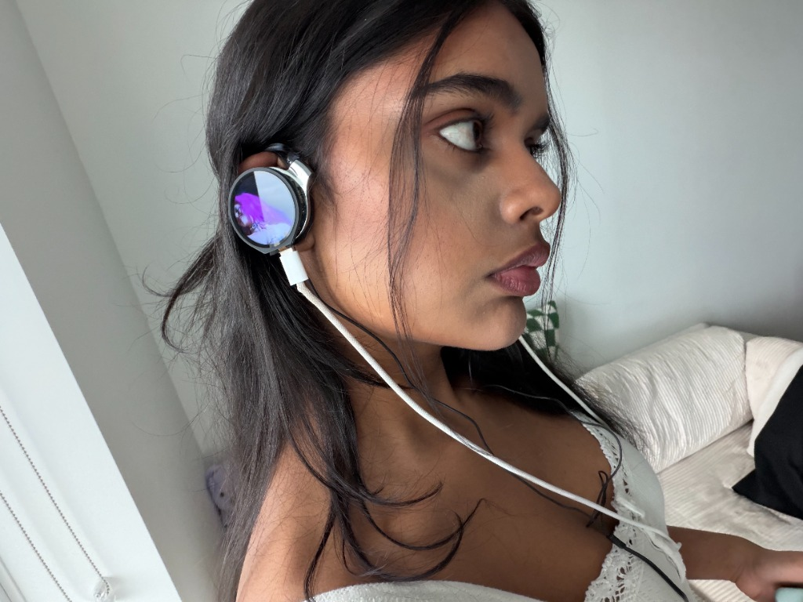

# Parasonic Display Headphones



A pair of 2000s clip-on headphones with a small round screen on each ear that loops a short music video clip. Each ear has its own ESP32-S3 board with a built-in 1.28" display and its own battery, stuck to the back of the earcup. The headphones still work as normal headphones; the screens are purely for show.

The clips are stored on the boards, so there is no SD card, Wi-Fi or laptop needed once they're uploaded. Tap a screen to switch between the two clips.

| What happens | On the screen |
| --- | --- |
| Power on (plug in battery) | Clip starts looping |
| Tap the screen (or press BOOT) | Switches to the other clip |
| Plug in USB-C | Keeps playing while the battery charges |

## Equipment

- 2 × Waveshare **ESP32-S3-Touch-LCD-1.28** (round 240×240 touch display, 16MB flash, 2MB PSRAM). The non-touch **ESP32-S3-LCD-1.28** also works, see [Touch vs non-touch](#touch-vs-non-touch)
- 1 × pair of clip-on headphones with a flat earcup back about 38 mm across (built on the Panasonic RP-HZ47)
- 2 × 3.7V LiPo battery, ~300 mAh, with protection circuit and **MX1.25 2-pin** plug
- 3M VHB double-sided foam tape
- Electrical tape
- USB-C **data** cable
- A computer with Arduino IDE 2, Python 3 and ffmpeg

## Quick start

1. **Install the ESP32 boards in the Arduino IDE.** Go to *Settings*, add `https://espressif.github.io/arduino-esp32/package_esp32_index.json` to *Additional boards manager URLs*, then install **esp32 by Espressif Systems** (3.x) in the Boards Manager.
2. **Install the libraries.** In the Library Manager, install **GFX Library for Arduino** (by moononournation) and **JPEGDEC** (by Larry Bank).
3. **Install ffmpeg.** macOS `brew install ffmpeg`, Windows `winget install ffmpeg`, Linux `sudo apt install ffmpeg`.
4. **Make your clips.** Drop your videos in `videos/`, then run the converter once per ear:
   ```bash
   python3 convert_video.py videos/song.mp4  left  --start 42 --seconds 10
   python3 convert_video.py videos/other.mp4 right --start 10 --seconds 10
   ```
   This writes `firmware/HeadphoneScreen/video_left.h` and `video_right.h`.
5. **Set the board options.** Open `firmware/HeadphoneScreen/HeadphoneScreen.ino`, select **ESP32S3 Dev Module** and your USB port, then in *Tools*: Flash Size **16MB (128Mb)**, Partition Scheme **Custom**, PSRAM **QSPI PSRAM**, USB CDC On Boot **Enabled**, Upload Speed **921600**.
6. **Upload to the first board.** At the top of the sketch set `START_VIDEO 0`, click Upload (compiling takes a minute or two, the clips are big), press RST.
7. **Upload to the second board** with `START_VIDEO 1`.
8. **Plug in the batteries** (check polarity first, see below) and stick everything to the headphones.

## Converting clips

`convert_video.py` runs on your computer. It centre-crops the video to a square, scales it to 240×240, encodes it as 20 fps MJPEG and writes the frames into a C header the sketch includes.

| Option | What it does |
| --- | --- |
| `left` / `right` | Which ear the clip is for |
| `--start N` | Begin N seconds into the video (e.g. the chorus) |
| `--seconds N` | Clip length. 10–15 s per ear is a good target |
| `--fps 20` | Frame rate (default 20) |
| `--quality 6` | 2 = best and largest … 10 = smallest (default 6) |

Both clips together need to fit in about 14 MB, which works out to roughly 0.5 MB per second of video in total. The script prints the size when it finishes. The same clip can go on both ears, just run it twice.

## Layout

```
                     clip hanger (stock, rotating)
                            +----------+
                            |          |   <- hooks over the ear
                    +-------+----------+-------+
                 +--|      .------------.      |--+
                /   |   .--| LiPo 300   |--.   |   \
               |    |  /   | mAh        |   \  |    |
               |    | |    '-----+------'    | |    |  <- round screen
               |    | |   .------+------.    | |    |     (video here)
               |    | |   | Waveshare   |    | |    |
               |    | |   | ESP32-S3    |    | |    |
                \   |  \  | 1.28" board |   /  |   /
                 +--|   '-+------+------+-'    |--+
                    +------------+-------------+
                                 |
                          USB-C port facing DOWN
                                 |
                    headphone audio cable (untouched)
```

Layer stack from the ear outward:

| Layer | Notes |
| --- | --- |
| Foam earpad | Stock |
| Driver + plastic back shell | Stock |
| VHB foam tape | Full disc, cut to the shell |
| LiPo battery | Wrapped in electrical tape, flat side down, lead toward the USB-C edge |
| VHB foam tape | Small pieces, leave the battery socket clear |
| Back of the board | Electrical tape over the ESP32 module, header pins and socket |
| Board + round screen | Glass faces outward, nothing taped over it |

Adds about 13 mm of thickness and 17 g per ear (board ~10 g, battery ~7 g). The 36 mm board sits on a 38 mm earpad, so the cup looks like it *is* the screen.

## the build process

Here's the process of how to build this on your own.

### step 1: pick the right pins

the Waveshare board has the screen, touch and battery charger already wired up, so there's nothing to solder. the only thing the sketch needs to know is which version you have, because two pins differ.

#### touch vs non-touch

| Signal | Touch-LCD-1.28 | LCD-1.28 (non-touch) |
| --- | --- | --- |
| SCK / MOSI / CS / DC | 10 / 11 / 9 / 8 | same |
| LCD MISO | 12 | none |
| LCD RST | **14** | **12** |
| Backlight | **2** | **40** |
| Touch SDA / SCL / INT / RST | 6 / 7 / 5 / 13 | no touch chip |
| Battery voltage (ADC) | 1 | 1 |

set `TOUCH_VERSION` at the top of the sketch to `1` for touch or `0` for non-touch. the touch board has a second thin ribbon cable from the glass to the PCB. on the non-touch board the BOOT button switches clips instead of tapping.

### step 2: make the clips

pick a 10–15 second section of each video and run `convert_video.py` for `left` and `right`. the frames are stored as plain JPEGs in `video_left.h` and `video_right.h`, and the sketch decodes them one by one with JPEGDEC straight out of flash, so there's no SD card.

### step 3: upload

open `firmware/HeadphoneScreen/HeadphoneScreen.ino`. the `partitions.csv` in the same folder gives the sketch a 15 MB app partition, which is why *Partition Scheme* has to be **Custom**. set `START_VIDEO` to `0` for the left board and `1` for the right, then upload each one. if the upload won't connect, hold **BOOT**, tap **RST**, release **BOOT** and try again.

### step 4: battery

> **Check the polarity before plugging in.** The MX1.25 socket is not standardised. Look for the **+** and **−** marks next to the socket on the board and make sure the **red** wire goes to **+**. If it's backwards, lift the tiny metal tab inside the plug with a pin, pull the wires out and swap them.

with USB unplugged, connect the battery and the screen should come on. plug USB-C back in and the onboard charger tops it up. expect roughly 1.5–2 hours per charge at full brightness; lower `BRIGHTNESS` to stretch it. there's no power switch, so unplug the battery to turn it off.

### step 5: mount it

dry-fit everything with masking tape first. VHB can't be repositioned once it's pressed down.

1. put electrical tape over the back of the board (all exposed metal), leaving the battery socket reachable
2. wrap the battery in electrical tape and plug it in with a little slack in the lead, never stretched or pinched
3. stick the battery to the back of the board with small pieces of VHB
4. cut a VHB disc for the earcup back shell and press the stack on, USB-C pointing down toward the headphone cable
5. put them on and check the video is upright

### step 6: rotation

because the two boards are mirrored on your head, one of them will usually be upside down. change `ROTATION` at the top of that board's sketch (`0`–`3`, 90° steps, typically `0` on one ear and `2` on the other) and re-upload. the USB-C port is still reachable once mounted.

## Tuning and troubleshooting

| Problem | Try this |
| --- | --- |
| Black screen | Check `TOUCH_VERSION` matches your board |
| Video sideways or upside down | Change `ROTATION` (0–3) and re-upload |
| Stripes or glitches in the picture | Change `SPI_SPEED` to `40000000` |
| Too bright on camera / short battery life | Lower `BRIGHTNESS` (e.g. `150`) |
| Tap does nothing | Press BOOT instead; non-touch boards only have BOOT |
| Upload fails to connect | Hold BOOT, tap RST, release BOOT, upload again |
| `largest frame is N bytes` from the converter | Rerun with `--quality 8` or `10` |
| Sketch too big | Shorten clips with `--seconds` or raise `--quality` |
| `ffmpeg: command not found` | Install ffmpeg (Quick start step 3) |
| Board won't run from battery | Check polarity (step 4), or charge it over USB first |
| Headphones tilt outward | Move the battery to the inside of the clip hanger, or a dab of hot glue at the hanger pivot |

## Files

| Path | What it is |
| --- | --- |
| `convert_video.py` | Turns an mp4 into `video_left.h` / `video_right.h` |
| `videos/` | Put your source videos here |
| `firmware/HeadphoneScreen/HeadphoneScreen.ino` | The firmware: loops a clip, tap to switch |
| `firmware/HeadphoneScreen/partitions.csv` | Flash layout (15 MB for the sketch + clips) |
| `firmware/HeadphoneScreen/video_*.h` | Generated clips, made by the converter |
| `images/` | The photo shown at the top |
